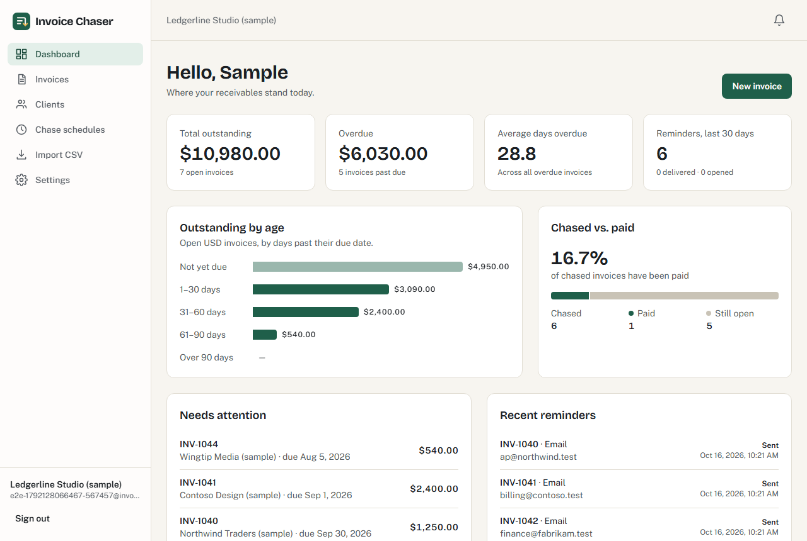
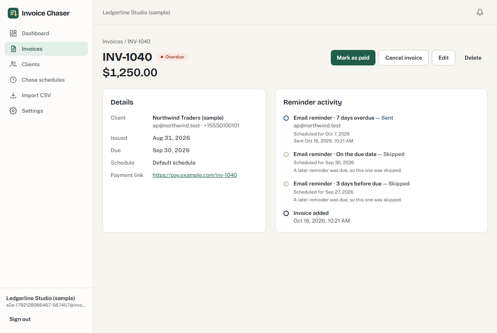
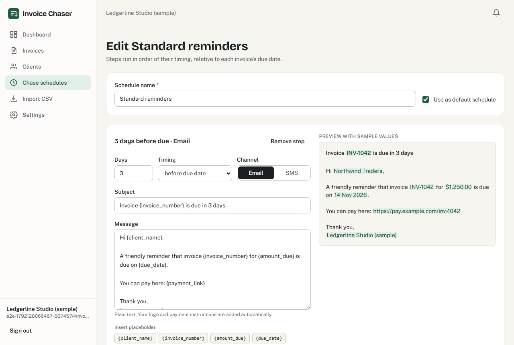
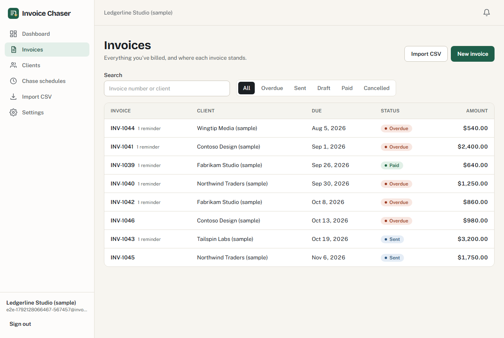
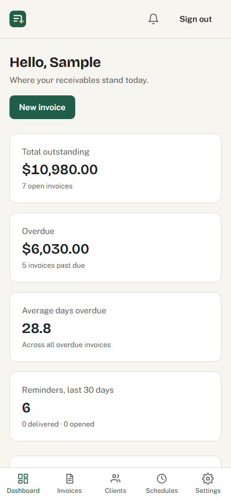

# Invoice Chaser

Automated accounts-receivable follow-up. Invoice Chaser tracks unpaid invoices and sends scheduled email and SMS payment reminders on a schedule you control — then stops the moment an invoice is paid.

**Live demo:** not deployed yet.



<sub>Screenshots use sample data generated by `web/e2e/screenshots.spec.js`; every client name is marked “(sample)”.</sub>

## Features

| | |
|---|---|
| **Accounts** | Email/password sign-up and sign-in (bcrypt, expiring bearer tokens). Company profile with logo, timezone, currency, payment terms, default payment link and bank details. |
| **Clients & invoices** | Create, edit and delete clients and invoices. Statuses: Draft, Sent, Overdue, Paid, Cancelled — with guarded transitions; Sent invoices become Overdue automatically. |
| **CSV import** | Bulk-import clients or invoices. Every row is validated and previewed before anything is saved; new clients are created from invoice rows. |
| **Chase schedules** | Build schedules of reminder steps (e.g. 3 days before due, on the due date, 7 days overdue) on email or SMS, with a placeholder editor and live preview. |
| **Automation** | An hourly scheduler queues the day's reminders after 9:00 in each user's timezone. Jobs retry 3 times, then alert the user in the app and by email. |
| **Auto-pause** | Marking an invoice paid cancels queued reminders, and every job re-checks the invoice right before sending. |
| **Dashboard** | Outstanding total, overdue amount, average days overdue, aging buckets, and chased-vs-paid success rate. |
| **Activity log** | Per-invoice timeline of every reminder: scheduled, sent, delivered, opened, skipped, failed — plus what's coming up next. |

<table>
<tr>
<td></td>
<td></td>
</tr>
<tr>
<td></td>
<td align="center"></td>
</tr>
</table>

## How reminders are decided

Each step fires on `due date ± offset`, in the account's timezone.

- **Before-due and on-due steps fire only on their exact day.** If the scheduler missed that day, the step is skipped rather than sending a stale "due in 3 days" message.
- **Overdue steps catch up.** If several were missed, only the latest one the client can receive is sent; earlier ones are logged as skipped, so a client never gets a burst of messages.
- **Steps on a channel the client can't receive** (no phone number, SMS opt-out, no email) are skipped without blocking the other channel.
- A unique `(invoice, step)` row is claimed before a job is queued, so re-runs and parallel workers can never send the same reminder twice.

## Tech stack

- **API:** PHP 8.4, Laravel 13, Sanctum (bearer tokens), database queue, Laravel scheduler, MySQL 8
- **Web:** React 19 + Vite, React Router, Tailwind CSS 4, Axios — plain JavaScript/JSX
- **Messaging:** Laravel Mail (SMTP/Mailgun) for email, Twilio REST API for SMS, both with signed delivery webhooks
- **Tests:** PHPUnit feature tests (59), a throughput benchmark, and Playwright end-to-end tests

The SRS specified Laravel 11, which no longer receives security fixes; the project uses the current stable Laravel instead.

## Local setup

Requirements: PHP 8.3+ (with `pdo_mysql`, `mbstring`, `fileinfo`), Composer, MySQL 8, Node 20+.

```bash
git clone https://github.com/fazal305/invoice-chaser.git
cd invoice-chaser
```

**API**

```bash
cd api
composer install
cp .env.example .env
php artisan key:generate
```

Create a database and user, put them in `api/.env` (`DB_DATABASE`, `DB_USERNAME`, `DB_PASSWORD`), then:

```bash
php artisan migrate
php artisan serve --port=8471
```

In two more terminals, run the queue worker and the scheduler:

```bash
php artisan queue:work --tries=4
```

```bash
php artisan schedule:work
```

**Web**

```bash
cd web
npm install
cp .env.example .env.local
npm run dev
```

Open http://localhost:5471 and create an account. A starter chase schedule is created for you.

To send today's reminders immediately instead of waiting for the hourly run: `php artisan chase:run --now`.

## Environment variables

**API (`api/.env`)** — see `api/.env.example` for the full list.

| Variable | Purpose |
|---|---|
| `APP_URL` | Public URL of the API (used to verify Twilio inbound webhooks) |
| `FRONTEND_URL` | Allowed CORS origin(s), comma-separated; the first is used in alert emails |
| `DB_*` | MySQL connection |
| `QUEUE_CONNECTION` | `database` (default) or `redis` |
| `SANCTUM_EXPIRATION` | Token lifetime in minutes (default 10080 = 7 days) |
| `CHASE_SEND_HOUR` | Local hour after which reminders go out (default 9) |
| `MAIL_MAILER`, `MAIL_HOST`, `MAIL_PORT`, `MAIL_USERNAME`, `MAIL_PASSWORD`, `MAIL_FROM_ADDRESS` | Outgoing email. Defaults to `log`, which writes emails to the log instead of sending. |
| `MAILGUN_WEBHOOK_SIGNING_KEY` | Enables `POST /api/webhooks/mailgun` for delivered/opened/bounced events |
| `SMS_DRIVER` | `log` (default, sends nothing) or `twilio` |
| `TWILIO_SID`, `TWILIO_AUTH_TOKEN`, `TWILIO_FROM` | Twilio credentials and sending number |
| `TWILIO_STATUS_CALLBACK_URL` | Public URL of `/api/webhooks/twilio/status` |

Point the Twilio number's incoming-message webhook at `/api/webhooks/twilio/inbound` so STOP/START replies update client opt-outs.

**Web (`web/.env.local`)**

| Variable | Purpose |
|---|---|
| `VITE_API_URL` | API base URL including `/api` |

## Tests

```bash
cd api && php artisan test                         # 59 feature tests (uses the invoice_chaser_test database)
cd api && php artisan test --testsuite=Benchmark   # 1,250-invoice throughput check
cd web && npx playwright test                      # end-to-end, starts both dev servers if needed
```

Throughput results are in [docs/performance.md](docs/performance.md): 1,250 invoices scanned and reminded in about 42 seconds on a laptop, against a 5-minute requirement.

## Security

Every request is scoped to the signed-in user, writes are validated server-side, uploads are allowlisted and content-sniffed, webhooks are signature-checked with replay protection, and the API sets no cookies. See [SECURITY.md](SECURITY.md) for details and how to report a vulnerability.

## Known limitations

- Not deployed yet. The API needs a host that can run a queue worker and the scheduler.
- No password reset or email verification (not in the SRS).
- Only manual entry and CSV import — no live sync with accounting platforms.
- One user per company; there are no team members or roles.
- "Opened" tracking depends on the email provider's open events, which many mail apps block.

## License

[MIT](LICENSE)
